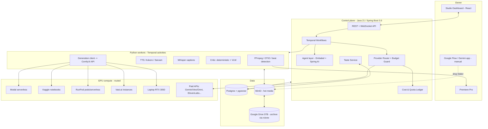

# CINESTACK — Handover Book for Claude Code

> **Working name:** `cinestack` (rename freely)
> **Owner / decision-maker:** Gendu (Java backend developer)
> **Prepared:** 16 Nov 2026, from a long research conversation with Claude
> **Status:** Research complete. Architecture agreed. **No code written yet.**
> **Revision:** R1, 16 Nov 2026 (scope widened, owner decisions recorded; see "Revision R1" below)
> **Audience:** Claude Code (primary), and the owner.

This is a serious, long-horizon project. Read this whole document before writing code. Where this book and the owner disagree, **the owner wins**. Facts marked *(verify)* were true when researched (Nov 2026). AI pricing and model availability change monthly, so re-check them before relying on them in code.

### Revision R1 (16 Nov 2026): read this first

**Scope widened.** The product is **text prompt → any complete, publish-ready video**, not only MelodySheep-style documentaries. MelodySheep is **one style preset** among several. The system itself decides what each video needs (format, length, style, narration or not, music, SFX, research, visual types). Where older text in this book says "film", "documentary" or "MelodySheep", read it as "video" and "the chosen style preset".

**Two modes on every stage.** Every stage (and every job inside it) runs in **Auto** (default) or **Manual**:
- *Auto:* the system does the stage and continues.
- *Manual:* the system prepares drafts, options, prompts or task cards and waits; the owner decides, edits or does the work (e.g. generates a clip in Flow), then the workflow continues.
- Mode is set per stage and per video, and can be switched mid-production. Manual actions are recorded as preference events (§18). This replaces the old "auto_approve" flags (§5.1, §5.3).
- *Review* (added 16 Nov 2026 at the owner's request): semi-auto. The stage runs, then waits a review window (default 10 minutes, set per video) for the owner to approve early, reject with notes, or hold (switch to Manual). If nobody responds, it continues automatically ("Done (review time ended)").

**v1 video types** (chosen by Claude on the owner's delegation): cinematic documentary, explainer, ambient/visual film (little or no narration), and Shorts/Reels. Character-driven dialogue with lip-sync stays out of v1.

**Owner decisions (R1):**
| # | Decision | Answer |
|---|---|---|
| 1 | Code location | Local first at `C:\dev\project-v` (outside OneDrive); push to a private GitHub repo later |
| 2 | v1 video types | Claude decides (see above) |
| 3 | Budget | No budget work now. **Build the product first**; pricing, GPUs, routing tuning and model choice are discussed later. Real spending still needs the owner's explicit approval each time |
| 4 | Music tool | Claude decides later or asks |
| 5 | Languages | Best choice: English first; dubs (Hindi, Tamil, Spanish, Portuguese…) later |
| 6 | Milestone order | **Backbone first, GPU benchmarks later** (M1 before M0; providers mocked until then) |
| 7 | Build tool | **Gradle** |
| 8 | Tool installs | Claude gives commands; owner runs them |
| 9 | Storage | Owner will buy and install a 1 TB SSD soon |

**Verified environment (16 Nov 2026):** Windows 11 Home; Asus TUF Gaming **A17 FA706IC** (2021, Ryzen 7 4800H → PCIe 3.0, so a Gen4 SSD runs at Gen3 speed); RTX 3050 Laptop 4 GB; 32 GB RAM; C: 454 GB with ~56 GB free. Installed: git, OpenJDK 24, Python 3.11, Node 26. Missing: WSL2, Docker Desktop, FFmpeg, uv, JDK 21 (Gradle toolchain will target Java 21).

---

## Table of contents

0. How to use this book (rules for Claude Code)
1. The idea in one page
2. The owner, constraints and resources
3. Creative north star
4. Scope: in, out, later
5. Inputs, outputs and human checkpoints
6. System architecture
7. Technology stack (with versions)
8. Domain model
9. Workflows (Temporal)
10. Agent crew
11. Provider router (the heart of the system)
12. Provider and model catalogue
13. Generation strategy (how to get quality cheaply)
14. Quality control (automatic critic)
15. Audio: narration, music, sound
16. Editing and the Premiere hand-off
17. Publishing: YouTube and Instagram
18. Taste learning
19. Storage architecture
20. Studio dashboard (UI)
21. Observability, cost ledger and security
22. Legal, licensing and provenance
23. Milestones and acceptance criteria
24. Repository layout
25. Testing and evaluation
26. Open decisions for the owner
27. Appendix A: Economics
28. Appendix B: Rejected options and why
29. Appendix C: Future roadmap
30. Appendix D: Lessons from the first demo
31. Appendix E: Glossary

---

## 0. How to use this book (rules for Claude Code)

1. **The owner makes the creative and product decisions; you build.** He has given full build control. Still, ask before anything irreversible, anything that spends real money, and anything that touches his accounts.
2. **Build in milestones (section 23).** Finish one, demo it, get approval, then start the next. Don't jump ahead to taste learning before films can be made.
3. **Never put secrets in code, logs, commits or chat.** Keys live in a local `.env` (git-ignored) or a secrets store. Give the owner a `.env.example` and let him fill in the values.
4. **Never violate a provider's terms of service.** Use one account per provider, don't farm free tiers with extra accounts, and don't use unofficial automation of consumer products (see Appendix B). The owner's Google account must never be put at risk.
5. **Quality first, cost second, automation third.** The goal is MelodySheep-level films, not volume.
6. **Prefer reusing proven engines over reinventing them** (ComfyUI, FFmpeg, OpenTimelineIO, Whisper and so on). Build the brain yourself; plug in the muscles.
7. **Everything the system does must be visible and overridable** in the dashboard: which provider, why, what it cost, and the alternatives.
8. **Keep facts current.** Before integrating a provider, check its current docs and prices; this book's numbers are a starting point.
9. **The owner's general coding preference:** minimal, targeted changes to existing code; no gratuitous restructuring. Explain non-obvious design choices briefly in PR descriptions.

---

## 1. The idea in one page

**Goal:** a personal AI video studio that turns a **text prompt** into a **complete, fully moving 4K video** (any length, from a 30-second Short to a 15-minute film) plus Shorts/Reels. It decides and produces everything the video needs: research, script, narration, music, sound, visuals, edit, captions and publishing kit. Every stage runs in **Auto** (default) or **Manual** mode, so the owner can direct as much or as little as he wants. Style comes from presets; **MelodySheep-style cinematic documentary is one preset**, not the only target. Goals: **quality first, then efficiency** (cost and time).

**What makes it different from existing tools:**

| Capability | Existing tools | Cinestack |
|---|---|---|
| Multi-agent script → storyboard → video | Yes (ViMax, ArcReel, LTX Studio, InVideo…) | Yes |
| **Credit-aware routing** across free tiers, rented GPUs, paid APIs, local models and the human | No | **Core feature** |
| **"Manual provider"**: the human generates in a consumer app (Google Flow) and a drop folder ingests the results | No | **Yes** |
| Automatic **vision-model critic** rejecting bad clips | Rare | **Yes** |
| **Learns the owner's taste** (choices, edits, YouTube retention) | No | **Yes** |
| Editable **Premiere Pro timeline** output | Rare | **Yes** |
| Durable, resumable, with approval gates at every step | Rare | **Yes (Temporal)** |
| Full publishing kit (dubs, Shorts, thumbnails, AI disclosure) | Partial | **Yes** |

**One-line architecture:** Java 21 + Spring Boot + **Temporal** control plane, **Embabel/Spring AI** agents, **Python workers** for media and ML, **ComfyUI** as the generation engine on rented or free GPUs, **Postgres + pgvector**, **MinIO** + **Google Drive** storage, a **React** studio dashboard, and **OpenTimelineIO → FCP7 XML** into Premiere.

---

## 2. The owner, constraints and resources

### 2.1 The owner
- Experienced **Java backend developer** (Spring Boot microservices, workflow and task-management systems, rule engines). Comfortable with distributed systems; Python is fine for workers.
- Wants an **advanced, sophisticated, excellent build**. Build time is not a constraint; quality is.
- Will act as director: approves concepts, scripts, shot picks and final cuts.

### 2.2 Hardware

| Item | Detail | Implication |
|---|---|---|
| Laptop | **Asus TUF Gaming A17** (FA706 or FA707 class) | Has **two M.2 NVMe slots**, so a second internal SSD can be added |
| GPU | **RTX 3050 Laptop, 4 GB VRAM** | Only light local AI (TTS, Whisper, small images). **No local video generation.** |
| RAM | 32 GB | Fine for the control plane, Docker and Premiere with proxies |
| Storage | **Verified:** 454 GB internal SSD, ~56 GB free. Owner is adding a **1 TB SSD** in the second M.2 slot soon | Until then: no media on C:. Media must live on the new SSD or Drive (section 19). The model is FA706IC (PCIe 3.0) |
| Uptime | Can run 24/7 | The control plane can run continuously on the laptop |
| OS | Assume **Windows** (verify). Prefer **WSL2 + Docker Desktop** for services | Paths and scripts must work on Windows |

### 2.3 Subscriptions and accounts
- **Google AI Pro**, free for 18 months via a Jio offer. Includes Flow credits (about 1,000/month plus 50 free daily *(verify)*; Veo 3.1 Fast about 20 credits per clip, Quality about 100 *(verify)*), Gemini app, Nano Banana image generation, Flow Music, and **5 TB Google storage** (the owner reports 5 TB).
  - **This Jio plan shows NO Colab compute units** (other AI Pro accounts reportedly get 200 a month). Don't count on Colab Pro.
  - **Consumer subscriptions are not APIs.** Flow and the Gemini app can't be called from code (section 12.2).
- **Claude Pro** (needed for office work) and **ChatGPT**.
- **Adobe Premiere Pro** (owner has it).
- Will create: Modal, Kaggle, RunPod, Vast.ai, a music service, a YouTube channel, Instagram, and the Gemini API (paid, separate billing).

### 2.4 Budget philosophy
- Exclude Claude Pro, Google AI Pro, Premiere and electricity from cost calculations (owner's instruction).
- Year one: keep cost per film low (about ₹1,000–3,500 for 12 minutes) while learning; scale spend only when views justify it (Appendix A).
- The system must enforce **hard budget caps** (monthly and per film) set by the owner.

---

## 3. Creative north star

### 3.1 Reference: MelodySheep (John D. Boswell)
- Cinematic science and history films ("Timelapse of the Future", "Timelapse of the Entire Universe" and similar). About 3.2M subscribers, 447M views, 137 videos *(Nov 2026)*.
- **Signature ingredients** the system must support:
  1. **Music-first:** the score drives the edit; big moments land on musical beats and swells.
  2. **"Flowmotion" camera:** continuous, smooth push-ins, pull-outs and drifts through scale (for example, solar system → Earth).
  3. **A big idea with a clock:** an on-screen timeline or counter (years, distance, scale) that drives the narrative.
  4. **Awe:** vast scales, light, atmosphere, slow reveals.
  5. Sparse, poetic narration (sometimes none), with captions and title cards.

### 3.2 The owner's reference clip
A 10-second vertical clip (1080×1920, 24 fps, HEVC): **a single continuous push-in from the solar system to Earth**, with a timer/counter overlay. This is the motion language to aim for: **real AI video, not panned stills**.

### 3.3 Quality bar
- **Real AI-generated motion in every shot.** Slideshows of panned still images are explicitly rejected (Appendix D).
- **4K master** (3840×2160). 8K is optional and only via upscaling (section 13.4).
- Consistent look across shots from different models (colour matching, style bible, later a style LoRA).
- Photorealism where it matters most: space, nature, landscapes and macro look most convincing; people and crowds are hardest.

### 3.4 Content strategy (agreed direction)
- **Niche:** science, history, technology and "big idea" documentaries. Education and science has the **highest median RPM** (about $10.22 per AIR Media-Tech data). Shorts earn about 3–14% of long-form RPM.
- **Language:** primarily **English for a global audience**, with **AI-dubbed versions** (Hindi, Tamil, Spanish, Portuguese and others) as extra audio tracks.
- **Format:** series rather than one-offs (for example, "Timelapse of India: 200 Million Years", "Timelapse of the Ocean"…).
- Avoid saturated generic topics (for example "How Bitcoin works") unless there's a fresh angle.

---

## 4. Scope: in, out, later

### In scope (v1)
- Topic → research → script → storyboard → animatic → shots → critic → selection → upscale → audio → timeline → 4K master → Premiere XML → publishing kit → Shorts.
- Credit- and budget-aware routing across all provider types, including the human.
- Owner approvals and overrides at every stage; auto-approve options per stage.
- Taste learning, plus YouTube Analytics feedback.
- Studio dashboard.

### Out of scope (v1)
- Character-driven drama with lip-synced dialogue (it's a later phase).
- Live-action footage, avatars and talking heads.
- Fully automatic publishing without a final human review.
- Anything requiring ToS-violating automation.

### Later (designed for, not built in v1; see Appendix C)
- Series production with a character bible and lip-sync.
- Public-domain book → narrated cinematic series (for example *The War of the Worlds*).
- Original anime/manga-style series (motion manga and full AI anime).
- Style LoRA training, multi-channel support, offering the tool to other creators.

### Explicitly NOT part of this project
The conversation also covered unrelated brainstorms: a deep/dark-web "search everything" idea, lost knowledge, 5/10/20-year project ideas, the "Graveyard of Ideas" artifact, a universe-by-frequency app, Google Maps as a game world, and similar. **Ignore them for this build.**

---

## 5. Inputs, outputs and human checkpoints

### 5.1 Input (a "Film Brief")
```yaml
topic: "Timelapse of India: 200 Million Years"   # required
target_duration_sec: 480                          # e.g. 360–720
style_preset: melodysheep_awe                     # from the style library
tone: "awe, slow reveals, poetic"
must_include: ["Deccan Traps", "Himalaya collision"]
references: [ "refs/push_in_solar_to_earth.mp4" ] # clips/images
narration:
  voice: "en_male_documentary_01"
  languages: ["en"]                # dubs: ["hi","ta","es"] later
music_mode: music_first            # music_first | narration_first
budget_inr: 3000                   # hard cap for this film
deadline: 2026-12-15
modes:                             # R1: auto (default) | manual, per stage
  default: auto
  overrides: { script: manual, final_approval: manual }
```

**R1:** only `prompt` is required (a free-text request such as "60-second Short on UPI fraud, punchy, Hindi"). Every other field is optional; the **Planner** (§10) infers what's missing from the prompt and the style presets and writes a `VideoPlan` the owner can see and, in manual mode, edit.

### 5.2 Outputs (the "Film Package")
1. **4K master** (3840×2160, H.264/H.265 high bitrate, plus an optional ProRes or DNxHR mezzanine).
2. **Premiere timeline** (FCP7 XML) with separate tracks: video, narration, music, SFX, captions/titles. Optionally OTIO too.
3. **Audio stems:** narration, music, SFX (WAV, 48 kHz).
4. **Captions:** SRT/VTT per language.
5. **Publishing kit:** 3 title options, description with sources, tags, chapters, 3 thumbnail options, pinned comment, AI-disclosure flags, and dubbed audio tracks.
6. **Shorts and Reels:** 3–5 vertical (1080×1920) 30–60 second cut-downs with hook text and captions.
7. **Production report:** per-shot provider, model, prompt, seed, cost, credits used, critic scores; licence and provenance for every asset; a fact-check list with citations.

### 5.3 Human checkpoints (each: approve / edit / regenerate / auto-approve)

> **R1:** these checkpoints now only apply when that stage is in **Manual** mode. In **Auto** (the default) the stage passes without waiting. Recommended default for publishing: keep `final_approval` manual (YouTube's mass-produced-content policy).
1. **Concept and outline:** the big idea, the "clock", act structure.
2. **Script:** narration text plus beat sheet.
3. **Storyboard and style frames:** keyframe stills for every shot **before** any video spend.
4. **Animatic:** stills + narration + music cut together. Story and pacing are locked here.
5. **Take selection:** the system shows the best 2–3 critic-approved takes per shot; the owner picks. Flow shots are generated by the owner (manual provider).
6. **Rough cut:** watch and leave timestamped notes, which become change requests.
7. **Final approval**, then upload as **private** to YouTube for a last check.

The owner can **take over any task manually** at any time (for example, upload his own clip for shot 37). The workflow must accept it and continue.

---

## 6. System architecture

### 6.1 Component diagram



### 6.2 Key architectural decisions
| Decision | Choice | Why |
|---|---|---|
| Orchestration | **Temporal** (self-hosted, MIT) | Durable long-running workflows, retries, signals for approvals and overrides, polyglot workers (Java + Python on one workflow) |
| Agent framework | **Embabel 1.0** on **Spring AI 1.1.x** | Typed, planning-based JVM agents from Spring's creator. Build on Boot 3.5; migrate when Embabel 2.0 adds Boot 4 / Spring AI 2.0 |
| Media and ML | **Python workers** | The whole AI and media ecosystem is Python |
| Generation engine | **ComfyUI** (headless API) with versioned workflow JSONs | Standard for open models; the same workflow runs on any GPU host |
| Database | **Postgres 16+ with pgvector** | Relational state plus embeddings (asset library search, taste) |
| Hot media | **MinIO** (S3-compatible) on the local SSD | One API for local and cloud workers |
| Archive | **Google Drive (5 TB) via rclone** | Free; cross-provider hand-off |
| Premiere hand-off | **OpenTimelineIO → FCP7 XML** | Premiere has imported FCP7 XML for years; its native OTIO import is still beta |
| UI | **React + TypeScript** (Vite) | Rich media grid, WebSocket live updates |
| Observability | **OpenTelemetry + Langfuse** (LLM traces) + Temporal UI | Every decision traceable |

### 6.3 Runtime topology (v1)
- **On the laptop (Docker/WSL2):** Temporal server, Postgres, MinIO, Langfuse, Spring Boot app, React dev server, a local Python worker (TTS, Whisper, FFmpeg, OTIO), and the rclone sync.
- **Remote GPU workers:** ephemeral. Each runs ComfyUI plus a thin worker agent that pulls jobs or is invoked serverlessly. Inputs and outputs go through MinIO (exposed securely) or Drive/rclone.
- **Laptop availability:** remote workers depend on the laptop's MinIO and Temporal. The laptop must stay awake while a production runs (the app should hold a "keep awake" lock and warn before sleep). Workers must also be able to write outputs to Drive so a sleeping laptop only delays ingestion, never loses work.
- **Network exposure:** never expose Postgres or Temporal publicly. For remote workers to reach MinIO, use a secure tunnel (Cloudflare Tunnel or Tailscale, to be decided) with scoped, short-lived credentials (pre-signed URLs).

---

## 7. Technology stack (with versions)

| Layer | Tech | Notes |
|---|---|---|
| Language (core) | **Java 21** | Records, virtual threads |
| Framework | **Spring Boot 4.1.x** (R1: was 3.5; see docs/adr/0001) | Embabel 1.5.x is built on Boot 4.1 |
| LLM integration | **Spring AI 1.1.x** | Gemini, Claude and OpenAI models via config |
| Agents | **Embabel 1.0** (GA 20 Jul 2026) | GOAP planning, typed actions |
| Workflows | **Temporal** (Java SDK for workflows, Python SDK for activities) | Self-hosted via docker compose |
| Workers | **Python 3.11+** | Temporal Python SDK |
| Generation | **ComfyUI** + custom nodes as needed | Workflows in `comfy/workflows/*.json`, versioned |
| Media | **FFmpeg**, **OpenTimelineIO** (+ `otio-fcp-adapter`), **librosa/madmom** (beats), **pyloudnorm** | |
| ASR | **faster-whisper** (large-v3-turbo, int8) | Runs on the laptop |
| TTS | **Kokoro** (local, English and Hindi, no Tamil), **Sarvam Bulbul** (Indian languages incl. Tamil, paid) | |
| Upscale / interpolation | Real-ESRGAN (fast), SeedVR2-class video upscaler (quality), RIFE (interpolation) | Evaluate at M0 |
| DB | Postgres 16 + pgvector | Flyway migrations |
| Object store | MinIO | Buckets per tier |
| Archive | rclone → Google Drive | |
| UI | React 18+, TypeScript, Vite, TanStack Query, a video player with frame stepping | |
| Observability | OpenTelemetry, Langfuse, Prometheus/Grafana (optional) | |
| Tests | JUnit 5, Testcontainers, Temporal test framework, pytest, Playwright | |

**LLMs to use (configurable by role):** the Gemini API free tier for text where allowed; Claude or GPT via API for script writing if the owner provides keys. The **VLM critic** uses a Gemini Flash-class model (section 14). The owner's Claude Pro and ChatGPT consumer subscriptions are **not** API keys.

---

## 8. Domain model

Core entities (Postgres). IDs are UUIDs; all tables have `created_at`/`updated_at`.

```text
Channel(id, name, default_style_id, languages[])
Film(id, channel_id, brief_json, status, budget_inr, spent_inr, deadline, workflow_id)
StyleBible(id, name, palette, lighting_rules, camera_language, negative_prompts, lora_refs[], reference_asset_ids[])
Concept(id, film_id, big_idea, clock_definition, acts_json, version, approved_by, approved_at)
Script(id, film_id, version, narration_md, beat_sheet_json, word_count, est_duration_sec, sources_json, approved)
MusicCue(id, film_id, asset_id, bpm, beat_times_json, sections_json, licence_id)
Scene(id, film_id, order, title, purpose, start_beat, end_beat)
Shot(id, scene_id, order, duration_target_sec, shot_type, camera_move, description,
     prompt_json, keyframe_asset_id, priority[hero|standard|filler], status, chosen_take_id,
     clock_value, overlay_text)
Take(id, shot_id, provider_id, model, params_json, seed, resolution, asset_id, cost_inr,
     credits_used, critic_scores_json, critic_verdict, owner_rating, rejected_reason, source[auto|manual])
Asset(id, kind[image|video|audio|subtitle|timeline|doc], uri_hot, uri_archive, sha256,
      width, height, fps, duration_sec, embedding vector, tags[], provenance_id)
Provenance(id, asset_id, provider, model, model_version, prompt, seed, licence_id, ai_generated bool, created_by)
Licence(id, name, commercial_use bool, attribution_required bool, url, notes)
Provider(id, name, kind[api|gpu_serverless|gpu_notebook|gpu_pod|local|manual], capabilities_json, enabled)
ProviderAccount(id, provider_id, label, secret_ref, quota_model_json, reset_rule, monthly_cap_inr)
QuotaSnapshot(id, account_id, period_start, period_end, units_total, units_used, source[api|ledger|manual])
Job(id, film_id, shot_id?, type, payload_json, status, provider_id?, attempts, started_at, finished_at, error)
CostEntry(id, film_id, job_id, provider_id, amount_inr, amount_usd, fx_rate, units, unit_type, ts)
RoutingDecision(id, job_id, candidates_json, scores_json, chosen_provider_id, reason_text, overridden_by_owner)
Approval(id, film_id, stage, decision[approve|reject|edit|override], notes, actor, ts)
PreferenceEvent(id, kind[pair|rating|edit_diff|override|retention], context_json, chosen, rejected, weight, ts)
Timeline(id, film_id, version, otio_uri, fcpxml_uri, notes)
Publication(id, film_id, platform, external_id, language_tracks[], ai_disclosure, published_at)
RetentionCurve(id, publication_id, points_json /* 100 points */, fetched_at)
```

Rules:
- **Every generated asset has a Provenance row** (no orphans).
- **Every money-spending job has a CostEntry**, even if it's estimated and later reconciled.
- **Every routing choice is stored** (RoutingDecision) for audit and learning.

---

## 9. Workflows (Temporal)

### 9.1 Top-level: `FilmProductionWorkflow(filmId)`
Stages run in order. Every stage can **pause for an approval signal**, and every stage is resumable after a crash.

```text
0  PlanStage (R1)       -> VideoPlan: format, length, aspect, style preset, needs (research? narration? music lead?), stage list
1  ResearchStage        -> sources + fact list (with citations)   [skipped if plan says not needed]
2  ConceptStage         -> big idea, clock, acts           [checkpoint 1]
3  ScriptStage          -> narration + beat sheet          [checkpoint 2]
4  MusicStage           -> select/generate score, beat map (music-first)
5  ShotPlanStage        -> scenes/shots timed to beats, prompts per model
6  KeyframeStage        -> one still per shot (cheap image models) [checkpoint 3]
7  AnimaticStage        -> stills + TTS scratch + music -> animatic.mp4 [checkpoint 4]
8  LibraryMatchStage    -> reuse existing clips from the asset library where good enough
9  DraftGenStage        -> low-res fast drafts for remaining shots (child workflows per shot)
10 FinalGenStage        -> full-quality render of chosen drafts (router decides provider)
11 CriticStage          -> deterministic + VLM scoring; auto-retry failures within budget
12 TakeSelectionStage   -> owner picks                     [checkpoint 5]
13 UpscaleStage         -> 720p/1080p -> 4K, interpolate to 24fps, colour match
14 AudioStage           -> final narration, SFX, ducking, loudness -14 LUFS
15 AssemblyStage        -> OTIO timeline -> FCP7 XML + 4K master render
16 RoughCutReview       -> notes -> change requests loop   [checkpoint 6]
17 PackagingStage       -> captions, dubs, titles, thumbnails, Shorts
18 FinalApproval                                         [checkpoint 7]
19 PublishStage         -> YouTube upload as PRIVATE (+ Instagram reels)
20 LearnStage (async, days later) -> fetch retention, update taste model
```

**R1 stage modes:** every stage reads its mode (`auto` | `manual`) from the video's settings at the moment it starts. Auto: run and continue. Manual: produce drafts or task cards, then wait for the owner's `approve`/`editArtifact`/`manualTakeUploaded` signal. A `setMode(stage, mode)` signal switches modes mid-run. The PlanStage decides which stages are needed; skipped stages are recorded, not silently dropped.

### 9.2 Child workflow: `ShotWorkflow(shotId)`
`plan prompt → route → generate (activity on chosen provider) → critic → (retry | escalate | done)`. Retries move to the next provider on quota or availability errors. A human override signal can at any point replace the shot with a manual take.

### 9.3 Signals and queries (all workflows)
- Signals: `approve(stage, notes)`, `reject(stage, notes)`, `editArtifact(stage, patch)`, `overrideProvider(jobId, providerId)`, `manualTakeUploaded(shotId, assetId)`, `pause()`, `resume()`, `setBudget(inr)`, `setAutoApprove(stage, bool)`.
- Queries: `status()`, `pendingApprovals()`, `costSoFar()`, `shotGrid()`.

### 9.4 Manual provider flow (Google Flow)
1. The router assigns a shot to `manual:flow` (a hero shot, or free credits available).
2. The system creates a **Flow task card**: exact prompt, reference images, aspect ratio, model choice (Veo 3.1 Quality/Fast, or Omni), duration, and a target filename.
3. The owner generates in Flow and drops the file into `drop/flow/<filmId>/<shotId>_*.mp4` (or uploads via the dashboard).
4. A **file watcher** ingests it, validates the resolution and duration, creates a Take with `source=manual`, and signals the workflow.
5. Flow credit usage is entered manually or estimated from the model choice (the ledger tracks it).

### 9.5 Determinism
Workflow code must be deterministic (Temporal rule). All I/O, LLM calls, randomness and time go in **activities**. Large payloads (media) are never passed through Temporal; pass asset IDs and URIs only.

---

## 10. Agent crew

Implement as Embabel agents/actions with typed inputs and outputs (Java records). Each agent's prompts are versioned files in `prompts/` and are evaluated (section 25).

| Agent | Input → Output | Notes |
|---|---|---|
| **Planner** (R1) | Prompt + style presets → VideoPlan (format, length, aspect, preset, which stages and assets are needed) | First agent to run; turns a free-text prompt into a structured plan |
| **Showrunner** | VideoPlan → stage orchestration hints, budget split | Coordinates; doesn't do creative work itself |
| **Researcher** | Topic → facts with sources | Web search via API; **every fact needs a source URL** |
| **Fact-checker** | Script + sources → flagged claims | Separate agent from Researcher |
| **Writer** | Concept + facts → narration + beat sheet | MelodySheep tone: sparse, poetic, awe; ~130–150 words/min |
| **Director** | Script + beat map → scenes and shots (type, camera move, duration, priority, clock value) | Enforces "flowmotion" continuity between shots |
| **Continuity / Style** | Shots + StyleBible → style-locked prompts, colour notes | Keeps the look consistent |
| **Prompt Engineers** (one per model family) | Shot spec → model-specific prompt and params | Veo, Wan, LTX, Flux etc. each have their own prompting idioms |
| **Critic** | Take + shot spec → scores, verdict, reasons | Section 14 |
| **Editor** | Chosen takes + audio + beats → OTIO timeline | Cuts on beats; pacing rules |
| **Sound** | Timeline → SFX cues, ducking plan, loudness targets | |
| **Packager** | Film → titles, description, chapters, thumbnails briefs, Shorts picks | |
| **Analyst** | Retention + choices → insights, taste updates | Post-publish |

---

## 11. Provider router (the heart of the system)

### 11.1 Responsibilities
For every job (image, video clip, upscale, TTS, music, LLM call), choose a provider that **meets the quality need**, **fits the budget**, **has quota left**, and **meets the deadline**. Fall back automatically. Explain every decision.

### 11.2 Provider registry (config, hot-reloadable)
```yaml
providers:
  - id: modal_a100
    kind: gpu_serverless
    capabilities: [video.wan22_14b, image.flux2, upscale.seedvr, interp.rife]
    cost: { unit: gpu_hour, usd: 0 }            # within free credit; then per-second billing
    quota: { type: monthly_usd, amount: 30, reset: "monthly@1" }
    reliability: 0.97
    speed_hint: { video.wan22_14b_720p_5s_min: 4 }   # measured at M0, auto-updated
  - id: kaggle_t4
    kind: gpu_notebook
    capabilities: [upscale.realesrgan, image.zimage_turbo, tts.kokoro, interp.rife]
    quota: { type: weekly_hours, amount: 30, reset: "weekly@SUN00:00Z" }
  - id: vast_4090_interruptible
    kind: gpu_pod
    capabilities: [video.wan22_14b, image.flux2, upscale.seedvr]
    cost: { unit: gpu_hour, usd_live: true }    # read the live marketplace price
    interruptible: true
  - id: runpod_4090_community
    kind: gpu_pod
    cost: { unit: gpu_hour, usd: 0.34 }
  - id: gemini_api_veo31
    kind: api
    capabilities: [video.veo31_fast, video.veo31_quality]
    cost: { unit: clip_8s, usd: { fast: 0.80, quality: 3.20 } }   # verify
  - id: manual_flow
    kind: manual
    capabilities: [video.veo31_quality, video.omni_flash, image.nano_banana]
    quota: { type: monthly_credits, amount: 1000, daily_bonus: 50 }  # verify
    latency: human
  - id: lightning_t4
    kind: gpu_notebook
    capabilities: [upscale.realesrgan, image.zimage_turbo, interp.rife]
    quota: { type: monthly_credits, amount: 15, reset: "monthly@1" }   # verify
  - id: local_laptop
    kind: local
    capabilities: [tts.kokoro, asr.whisper, ffmpeg, otio]
    cost: { usd: 0 }
```

### 11.3 Scoring (per job)
```
score(p) = w_q * quality(p, job.capability, shot_type)        # from the critic + owner-choice history
         - w_c * normalised_cost(p, job)
         - w_t * expected_latency(p) vs deadline
         + w_r * reliability(p)
         - penalty(if quota would be exceeded or budget cap breached → excluded)
```
- **Quality priors** start from config, then are learned per (provider, model, shot_type) via a **contextual bandit** (Thompson sampling over the critic score and owner acceptance).
- **Priority classes:** `hero` shots favour quality (Veo Quality / Flow); `standard` shots go to open models on cheap GPUs; `filler` goes to the cheapest acceptable option or library reuse.
- **Spend order (default policy):** library reuse → free quotas (Modal, Kaggle, Lightning, Flow) → local → cheapest paid GPU (Vast interruptible → Vast on-demand → RunPod) → paid APIs → ask the owner.
- **Deferral:** low-priority jobs can **wait for a quota reset** (for example, Kaggle on Sunday) instead of spending money, if the deadline allows.

### 11.4 Quota and credit tracking
- Many providers don't expose remaining credits. The **ledger counts usage itself** (CostEntry) and reconciles with provider APIs or invoices where possible.
- Detect exhaustion from errors (HTTP 402/429, quota messages) and immediately mark the account `exhausted_until`.
- Owner can enter manual balances in the dashboard (for example, Flow credits remaining).
- Live price fetch for marketplace providers (Vast); never hard-code market prices.

### 11.5 Budget guard
- Hard caps per film and per month; soft warnings at 70% and 90%.
- A job that would breach the cap is **blocked**, and an approval request goes to the owner with the cheapest alternative.

### 11.6 GPU session management (pods)
- Batch all pending jobs for a provider into one session. Start the pod, warm models (from Hugging Face or a cached volume, **not** from Google Drive), run the queue, upload results, and **shut down automatically when the queue is empty or after N minutes idle**.
- Delete ephemeral disks after use (Vast bills storage even while stopped).
- Handle interruption: idempotent jobs, results streamed to MinIO/Drive as each finishes, re-queue on preemption.

---

## 12. Provider and model catalogue (as researched, Nov 2026, verify)

### 12.1 GPU compute

| Source | What | Amount / price | Best use | Integration |
|---|---|---|---|---|
| **Modal** | Serverless GPUs | **$30/month free credit**, resets monthly (≈12 h A100 or 27 h A10) | Main video generation within free credit | Python SDK, fully automatic |
| **Kaggle** | Notebooks | **~30 GPU h/week** (P100 or 2×T4), 12 h sessions, resets Sun 00:00 UTC | Upscaling, images, interpolation, TTS | Official Kaggle API (push kernel, poll, fetch outputs). **Verify Kaggle's acceptable-use terms** for this kind of automated batch work before integrating |
| **Colab free** | Notebooks | Variable T4 hours | Overflow | Semi-manual; **owner's plan has no Colab Pro units** |
| **Lightning AI** | Studios | ~15 credits/month (~22 T4 h) | Backup | SDK, semi-automatic |
| **Vast.ai** | Marketplace | RTX 4090 about **$0.28–0.35/h** on-demand; interruptible from about $0.10/h | Bulk generation (interruptible) | API; prefer verified hosts |
| **RunPod** | Pods / Serverless | RTX 4090 community **$0.34/h**; A40 48 GB quoted to owner at **₹45/h**; serverless from about $0.58/h-equivalent | Reliable jobs, LoRA training, serverless endpoint later | API |
| **Laptop** | RTX 3050 4 GB | Free | TTS, Whisper, FFmpeg, OTIO, proxies | Local worker |

GPU sizing (agreed): **24 GB is the sweet spot** for video (Wan 2.2 14B). 16 GB works with quantisation. 48–80 GB only for LoRA training or very heavy runs, rented by the hour. An RTX 4090 is faster and cheaper per result than an A40 for this workload; the A40 lacks native FP8.

**SageMaker Studio Lab** closed to new users (Jul 2026). Don't integrate.

### 12.2 Google (owner's AI Pro + paid API)
- **Flow** (consumer app): Veo 3.1 and **Gemini Omni Flash**, credits per plan. **No official API.** Third-party "Flow APIs" that drive a consumer account were **rejected** (ToS risk, account-ban risk). Integration = **manual provider** (section 9.4).
- **Gemini API** (paid, separate billing): **Veo 3.1** (official API; about $0.80 Fast / $3.20 Quality per 8 s clip *(verify)*). **Omni Flash: conflicting research.** One finding said it is available only inside Flow; cost tables assumed an API at about $0.07/s, with the version cited as both 1.1 and 1.2. **Don't add Omni to the router until its API availability, model ID and price are confirmed.**
- The **Veo 3.1 Preview API** was shut down on 22 Oct 2026 and the **Sora API** on 24 Sep 2026, per earlier research. Re-check current Google model IDs before integration.
- **Nano Banana 2 / Pro** image models: about $0.067 (1K) / $0.151 (4K) for NB2; about $0.134 / $0.24 for Pro *(verify)*. Also usable free via the Gemini app (manual).
- The **Gemini API free tier** covers text models: use it for agents where its terms allow.

### 12.3 Open video models (run via ComfyUI)
| Model | Notes |
|---|---|
| **Wan 2.2 14B** | Best all-round open model; Apache-2.0; 720p; ~13 min per 5 s 720p clip on a 3090 (int8), ~8–12 min on a 4090; speed-LoRA variants are much faster at slight quality cost |
| **LTX-2.x** | Fast, native audio, claims 4K@50 fps at 22B params; heavier |
| **HunyuanVideo 1.5** | Most cinematic look; licence excludes EU/UK/South Korea users (owner is in India: check the licence anyway) |
| CogVideoX | Older; fallback only |

**Benchmark these at M0** on the actual rented GPUs. Don't trust published timings blindly.

### 12.4 Images
Z-Image Turbo (GGUF; fits small GPUs), FLUX.2 klein, Nano Banana (API/app). Used for keyframes, style frames and thumbnails.

### 12.5 Voice
- **Kokoro** (local, free; English and Hindi; **no Tamil**).
- **Sarvam Bulbul v4 Flash**: Tamil and Indian English; ~₹20 per 10k characters *(verify)*.
- **Navana Bodhi TTS**: ~₹12 per 10k characters *(verify)*.
- **ElevenLabs free plan does not allow commercial use.** Paid plans only if used.

### 12.6 Music (section 15)
AIVA (Pro for full copyright, MIDI export), ElevenLabs Music (licensed training data, commercial on paid plans, has an API), Stable Audio 2.5 (cleared training data, up to 190 s), Google Lyria / Flow Music (in AI Pro; check commercial terms). **Udio: avoid** (downloads disabled since the UMG settlement). **Suno:** commercial rights on paid plans but ongoing label lawsuits, so legal uncertainty.

### 12.7 LLMs
Configurable per agent role through Spring AI: Gemini (free tier where allowed), Claude API, OpenAI API. Track token cost in the ledger.

---

## 13. Generation strategy (how to get quality cheaply)

1. **Music-first:** lock or generate the score early; the beat map sets shot durations, so clips are generated at the right length (less waste).
2. **Animatic before video:** a full film from stills + scratch narration + music, approved by the owner, **before** any video spend. Removes shots that would have been cut anyway (expected to save up to ~50% of generation cost).
3. **Library match first:** search pgvector embeddings of past clips (including rejects) for reusable shots, such as Earth from orbit or star fields.
4. **Draft → final cascade:** generate cheap low-res or speed-LoRA drafts (2–4 variants), let the critic and owner pick, then render **only the winner** at full quality.
5. **Resolution plan:** generate at **720p–1080p**, upscale finals to **4K** (SeedVR2-class for quality, Real-ESRGAN for speed), interpolate to 24 fps (Wan outputs ~16 fps). **Native 4K only for special detail shots**, routed explicitly. **8K = upscale only**, optional.
6. **Hero vs standard:** ~10–20% of shots (opening, climax, key reveals) go to top models (Veo Quality via Flow/API); the rest go to open models on cheap GPUs.
7. **Image-to-video** from approved keyframes by default, for control and consistency.
8. **Budget about 3 generations per usable shot** (industry data: 164 clips for 41 used).
9. **Style LoRA** (later): after 2–3 films, train on the owner's best shots for a signature look and fewer retries.

---

## 14. Quality control (automatic critic)

Two layers, run on every take before the owner sees it.

**Layer 1: deterministic checks (cheap, Python/FFmpeg):**
- Resolution, fps and duration match the spec (± tolerance).
- Black or frozen frames, duplicate frames, flicker (frame-difference variance), sudden exposure jumps.
- Corrupt files; audio presence where expected.
- Watermark detection (should be none).

**Layer 2: VLM judge (Gemini Flash-class at full resolution):**
- Rubric-based, prompt-specific scoring on 1–5 scales: artifacts/morphing, prompt adherence, style-bible match, camera-move correctness, physical plausibility, "looks like real footage", continuity with neighbouring shots.
- Output JSON: `{scores:{...}, verdict: pass|retry|reject, reasons:[...], timestamps_of_issues:[...]}`.
- Research (WorldJen, 2026) shows Gemini-Flash-class judges at full resolution match human model rankings and catch artifacts that VBench-style metrics (downsampled to 224 px) miss.
- Calibrate thresholds against the owner's picks (taste data). Track critic and owner agreement as a KPI.

Only takes with `verdict=pass` are shown by default; the owner can reveal rejected ones.

---

## 15. Audio: narration, music, sound

- **Narration:** TTS per language with SSML-like pacing; scratch voice for the animatic, final voice after the script lock. Store per-line timings.
- **Music:**
  - Preferred workflow: **AIVA** (MIDI export, so it's editable and owned, with full copyright on Pro) for themes, **ElevenLabs Music / Stable Audio** for atmospheres, then the owner shapes the result in a DAW (Reaper or Cakewalk) or the system edits it to picture.
  - Beat and section detection → `MusicCue.beat_times` → drives the shot plan.
  - **"Commercial use" ≠ copyright ownership ≠ Content ID eligibility.** Never register AI music in Content ID.
- **SFX:** whooshes, rumbles, risers, impacts from free libraries or generated, placed by the Sound agent at cut points and reveals.
- **Mix:** ducking under narration; loudness target **-14 LUFS integrated** for YouTube, true peak ≤ -1 dBTP; stems exported separately.

---

## 16. Editing and the Premiere hand-off

- The **Editor agent** builds an **OpenTimelineIO** timeline: V1 shots, V2 overlays (clock, titles), A1 narration, A2 music, A3 SFX, plus a subtitles track (sidecar SRT).
- Cut rules: cuts on beats or downbeats; hold shots after key lines; no shot under ~1.5 s unless it's a montage; transitions mostly hard cuts and long dissolves in the MelodySheep style.
- Export **FCP7 XML** via the OTIO `fcp_xml` adapter, the reliable path into Premiere. Premiere's native OTIO import is beta and may drop sequence settings, so treat it as optional. Validate by importing into Premiere at M2 (owner test).
- Media paths in the XML must resolve on the owner's machine (relative to a project media root).
- Also render a **4K master** with FFmpeg directly, so a film can be finished without Premiere.
- **Proxies:** generate 1080p (or lower) proxies for smooth editing on the 3050 laptop. Premiere Media Cache and proxies must point to the media SSD, not the OS drive.
- Owner may use Premiere's own AI tools (Enhance Speech, Auto Ducking, Scene Edit Detection, Auto Reframe, Generative Extend) on top.

---

## 17. Publishing: YouTube and Instagram

**YouTube rules and limits (verify before building):**
- **Unaudited API projects can only upload as private.** Plan for manual publish, or apply for an API audit later.
- Uploads have their own quota bucket (~100/day). Fine.
- **AI disclosure is required** for realistic AI content; YouTube has auto-labelled undisclosed AI since **May 2026**. Always set the disclosure flag.
- **Inauthentic / mass-produced content policy (clarified Jul 2026)** affects monetisation, so human creative direction, original narrative and editing must be evident. This is another reason for the director-in-the-loop design.
- **YPP:** 1,000 subs + 4,000 watch hours (or 10M Shorts views) in 12 months; from **1 Feb 2027**: 8,000 hours or 20M Shorts views *(as researched)*.
- **Multi-language audio tracks:** upload dubs as additional audio tracks on the same video.
- **Thumbnail Test & Compare:** support 3 thumbnail options per video.

**Instagram:** Graph API supports the `is_ai_generated` flag; publishing cap is roughly 50–100 posts/day. Reels are cut from each film.

**Shorts and Reels generator:** pick the 3–5 highest-impact moments (critic plus retention heuristics), reframe to 9:16, add a hook line and captions, loop-friendly endings.

---

## 18. Taste learning

Signals (all stored as `PreferenceEvent`):
1. **Pairwise choices:** the owner picks take A over B (strongest signal).
2. **Ratings and reject reasons** (tags such as "too fast", "morphing", "wrong colour").
3. **Edit diffs:** the owner's changes to scripts, prompts and timelines vs the system's drafts.
4. **Overrides:** provider, model and setting overrides.
5. **YouTube retention:** the Analytics API returns a **100-point curve** per video (`elapsedVideoTimeRatio` 0.01–1.0, `audienceWatchRatio`, `relativeRetentionPerformance`). Map dips and peaks onto timeline shots, music cues and script beats.

Uses:
- **Reward model** (start simple: logistic regression or gradient boosting on take features + critic scores + embeddings; later a learned ranker) that pre-ranks takes.
- **Router bandit** updates (provider/model quality per shot type).
- **Prompt optimisation** (DSPy-style): evolve prompt templates toward accepted outputs; A/B test against the eval set.
- **Style profile:** a living document of the owner's preferences, injected into agent prompts.
- **Post-mortem:** after each film, auto-generate a "what worked / what didn't" note.

Guardrail: taste learning can **rank and suggest**, but it never silently overrides an explicit owner rule.

---

## 19. Storage architecture

| Tier | Where | Holds | Notes |
|---|---|---|---|
| **Hot** | Internal SSD (or a **second internal M.2 SSD**, recommended) | Current film media in MinIO, DB, Premiere cache/proxies | Laptop has 2 M.2 slots; a 1 TB Gen4 NVMe costs about ₹15,700 (Crucial P310) in Nov 2026; prices are inflated in 2026 |
| **Archive** | **Google Drive 5 TB** via rclone | Finished films, all takes (asset library), backups | ~750 GB/day upload cap per account; not for live editing; use "stream" mode for Drive for desktop with its cache on the media disk |
| **Ephemeral** | GPU hosts | Models and temp outputs | Model weights from **Hugging Face** (not Drive); outputs pushed to MinIO/Drive as each finishes |
| **Optional** | External 10 Gbps USB-C NVMe | Backup / overflow | Only if internal space runs short |

If the OS drive has only ~40 GB free: OS + apps only on it; everything else on the media SSD. The pipeline auto-moves finished films to Drive.

The **asset tracker** knows where each asset lives (hot URI and archive URI) and can rehydrate from Drive on demand.

---

## 20. Studio dashboard (UI)

Screens:
1. **Films:** list, status, spend vs budget, next pending approval.
2. **New film:** brief form (section 5.1), style preset picker, budget.
3. **Approvals inbox:** all pending checkpoints with diff views (script vs previous version).
4. **Script editor:** narration with beat markers; inline fact-check flags and sources.
5. **Storyboard / Animatic:** keyframe strip, a playable animatic, per-shot notes.
6. **Shot grid (main screen):** each shot shows its spec, 2–3 takes side by side (synced playback, frame stepping), critic scores and reasons, provider/cost, buttons (pick, regenerate, regenerate on a specific provider, upload manual take, "send to Flow" card).
7. **Flow tasks:** queue of manual-provider cards with copyable prompts, reference images and a drop/upload target.
8. **Router and budget:** live provider status, quotas and resets, spend charts, routing-decision log with reasons, override controls, budget caps.
9. **Rough cut review:** player with timestamped comments → change requests.
10. **Publish:** titles/thumbnails/description editor, language tracks, disclosure toggles, upload status.
11. **Insights:** retention curves overlaid on the timeline, taste-model stats, critic and owner agreement.
12. **Settings:** providers and keys (references only; values come from env/secrets), style bibles, voices, defaults.

Live updates via WebSocket from workflow events. A desktop-first layout; mobile read-only for approvals is a nice-to-have.

---

## 21. Observability, cost ledger and security

- **Tracing:** OpenTelemetry across Java and Python; Langfuse for every LLM/VLM call (prompt, model, tokens, cost, latency).
- **Temporal UI** for workflow history.
- **Cost ledger:** every job writes a CostEntry (INR and USD with the FX rate). Monthly report per provider and per film.
- **Alerts:** budget thresholds, a provider down, a pod left running more than N minutes idle (critical: auto-stop), quota exhausted.
- **Security:**
  - Secrets only in `.env` (git-ignored) or an OS keychain/secret manager; `.env.example` committed.
  - Remote workers get **scoped, short-lived** credentials (pre-signed URLs). Never the master keys.
  - No public exposure of internal services; use a tunnel.
  - The owner's email and accounts are private; never send them to third parties.
  - One account per provider; respect all ToS.

---

## 22. Legal, licensing and provenance

- **Provenance ledger** on every asset (section 8). Exportable per film as part of the production report.
- **Licences:** record each model's licence (Wan: Apache-2.0; HunyuanVideo: regional restrictions; others to check) and each music track's licence and plan at generation time.
- **Copyright:** only adapt **public-domain** works, the owner's own works, or licensed works. No modern copyrighted books, manga or characters.
- **AI disclosure** on YouTube and Instagram is always on for realistic AI content.
- **Facts:** documentaries must be accurate; the fact-checker agent and source list are mandatory before script approval.
- **Music:** no AI music in Content ID; keep plan receipts for commercial-use proof.

---

## 23. Milestones and acceptance criteria

> Each milestone ends with a demo to the owner and his approval. Rough part-time effort (~10 h/week) is shown; the owner has said time is not a constraint.
>
> **R1 order: M1 → M2 (mocked or free providers) → M0 benchmarks when the owner approves spending → M3 → M4 → M5.** M1 also delivers the Auto/Manual mode switch on every stage and the Planner stage. M2 uses free tiers or mocked generation until the owner approves paid GPU time; producing a real 3–5 minute video will likely need some paid GPU hours, so ask first.

### M0: Spikes and benchmarks (1–2 weeks)
- Rent a 4090 (Vast and RunPod) for 1–2 hours each; run ComfyUI with Wan 2.2 14B (standard and speed-LoRA), measure **minutes per 5 s 720p clip** and quality. Same on Modal (A100) and Kaggle (T4: images, upscale).
- Test a 4K upscaler (SeedVR2-class vs Real-ESRGAN) on 3 clips; measure time and quality.
- Test the FCP7 XML import into the owner's Premiere with a toy timeline.
- Test the Gemini API (Veo, Omni) access and pricing on the owner's account (only if he approves the spend).
- **Done when:** a benchmark report with real numbers updates the router config defaults, and the owner confirms the Premiere import works.

### M1: Backbone and data (2–3 weeks)
- Monorepo, docker compose (Temporal, Postgres+pgvector, MinIO, Langfuse), Spring Boot app, Python worker, Flyway schema (section 8), auth-less local dashboard skeleton.
- `FilmProductionWorkflow` skeleton with stages as stubs, signals and queries working, approvals from the UI.
- Cost ledger and provider registry (config load, no routing yet).
- **Done when:** the owner creates a film from a brief, sees stages progress, approves stubs in the UI, and restarting the laptop resumes the workflow.

### M2: First film path (script → animatic → shots → Premiere) (3–4 weeks)
- Researcher, Fact-checker, Writer and Director agents; music-first beat map; keyframes; animatic render.
- ComfyUI generation client (one GPU provider, e.g. Modal) + **manual Flow provider** with drop folder.
- Basic deterministic critic; take selection UI (shot grid).
- Upscale and interpolate; TTS; captions; OTIO → FCP7 XML; FFmpeg 4K master.
- **Done when:** a real 3–5 minute film is produced end-to-end with the owner's approvals, opens in Premiere as an editable timeline, and a 4K master exists. (**Films can start being made here.**)

### M3: Router and multi-provider (3–4 weeks)
- Full router (scoring, quotas, resets, budget guard, deferral, fallbacks), providers: Modal, Kaggle, Vast, RunPod, local, Gemini API, manual Flow.
- Pod session manager with auto-shutdown; interruption handling.
- Router and budget dashboard.
- **Done when:** a film runs with free quotas exhausted mid-batch and the system switches providers automatically, stays under the budget cap, and logs every decision.

### M4: Quality layer (2–3 weeks)
- VLM critic with rubric, calibration; asset library with embeddings and reuse; eval suite (section 25); provenance export; production report.
- **Done when:** the critic and owner agree on ≥70% of pass/reject calls on an eval set, and library reuse works on a second film.

### M5: Publishing and learning (3–4 weeks)
- Packaging (titles, descriptions, chapters, thumbnails, Shorts/Reels, dubs as audio tracks), YouTube upload (private), Instagram.
- Taste learning: preference events, reward-model ranking, bandit routing, retention fetch and timeline mapping, post-mortem notes.
- **Done when:** a published film's retention curve shows up mapped onto its shots in the UI, and the next film's take ranking measurably uses past choices.

### M6+ (later): style LoRA training job, series/character bible + lip-sync, book-to-series mode, anime mode, multi-channel.

---

## 24. Repository layout (proposed)

```text
cinestack/
├─ CLAUDE.md                      # working rules for Claude Code (provided)
├─ docs/
│  ├─ HANDOVER.md                 # this book
│  ├─ adr/                        # architecture decision records
│  └─ benchmarks/                 # M0 results
├─ infra/
│  ├─ docker-compose.yml          # temporal, postgres(pgvector), minio, langfuse
│  └─ rclone/                     # config templates (no secrets)
├─ control-plane/                 # Java 21, Spring Boot 3.5
│  ├─ src/main/java/.../workflow/ # Temporal workflows (deterministic)
│  ├─ src/main/java/.../agents/   # Embabel agents
│  ├─ src/main/java/.../router/   # provider router, budget guard, ledger
│  ├─ src/main/java/.../api/      # REST + WebSocket
│  └─ src/main/resources/db/migration/  # Flyway
├─ workers/                       # Python 3.11+
│  ├─ activities/                 # temporal activities
│  ├─ media/                      # ffmpeg, otio, beats, loudness
│  ├─ critic/                     # deterministic + VLM
│  ├─ providers/                  # modal, kaggle, vast, runpod, gemini, local clients
│  └─ comfy_client/
├─ comfy/
│  ├─ workflows/                  # versioned ComfyUI JSON graphs
│  └─ images/                     # docker images for GPU hosts
├─ prompts/                       # versioned agent prompts
├─ evals/                         # golden shots, rubrics, scripts
├─ dashboard/                     # React + TS
├─ config/
│  ├─ providers.yaml
│  ├─ styles/                     # style bibles
│  └─ voices.yaml
├─ drop/flow/                     # manual provider drop folder (git-ignored)
└─ .env.example
```

---

## 25. Testing and evaluation

- **Unit:** router scoring, budget guard, quota resets, ledger maths, OTIO/XML generation, beat-to-shot timing.
- **Workflow tests:** Temporal test environment with time skipping; crash/resume; signal handling; provider failure → fallback.
- **Integration:** Testcontainers (Postgres, MinIO); mocked providers with recorded responses; one opt-in "real GPU" smoke test.
- **Golden-shot eval set:** ~50 shots with owner-labelled pass/fail and pairwise preferences, used to evaluate critic thresholds, prompt templates and model changes before rollout.
- **Prompt evals:** any change to `prompts/` runs against fixed briefs; compare outputs (LLM-as-judge plus owner spot check).
- **Premiere import check:** XML validated against the FCP7 DTD and re-imported into OTIO (round trip) in CI.
- **Cost regression:** a simulated film run must stay within the expected cost envelope.

---

## 26. Open decisions for the owner

> **R1:** items 1, 3 (types), 4 and 9 are answered in "Revision R1" at the top. Still open: music tool (Claude to propose), channel name/branding, remote-worker connectivity, LLM keys, paid Gemini video in v1, budget caps (deferred).

1. **Where the code lives:** a GitHub repo (private) or a folder on the laptop? *(Recommendation: private GitHub repo plus a local clone.)*
2. **Music tool and plan:** AIVA Pro, ElevenLabs Music Starter, or both?
3. **First film topic** and channel name/branding.
4. **Budget caps:** monthly and per film.
5. **Remote-worker connectivity:** Cloudflare Tunnel vs Tailscale.
6. **LLM providers and keys** for agents (Gemini API, Claude API, OpenAI API).
7. Whether to enable paid **Gemini API video** (Veo/Omni) at all in v1, or rely on Flow (manual) for hero shots.
8. Add the **second internal SSD** now or later.
9. Languages for the first dubs.

---

## 27. Appendix A: Economics (as estimated, Nov 2026)

### Cost per 12-minute 4K video (≈144 shots, ≈432 generations, Wan 2.2 on rented 4090)
| Setup | GPU hours | Cost |
|---|---|---|
| Lean (speed LoRA, fast upscale), Vast interruptible + free tiers | ~30–45 h | **≈ ₹1,000** |
| Balanced (standard quality), RunPod/Vast on-demand | ~65–100 h | **≈ ₹2,500–3,500** |
| Hybrid with ~30% Veo Quality via paid API | — | ≈ ₹20,000–25,000 |
| All Veo 3.1 Quality via API | — | ≈ ₹1,00,000 |

Plus music subscription (~₹500/month), storage, and ₹0 for narration (Kokoro), captions, editing and thumbnails.

### Revenue reference
- RPM (creator share): Indian audience ₹40–120 per 1,000 views; global ~$3–6; US/UK education ~$6–10 (median for education ~$10.22).
- Realistic views: median first video for channels still under 1,000 subscribers is ~181 views; global long-form average ~6,000; the top 10% of a channel's videos bring ~half its views.
- Break-even per video at a global RPM ≈ 3,000–8,000 views.
- Year-one risk with the lean setup ≈ ₹20,000–70,000. Probability of >₹1 lakh profit: Claude's rough judgment was ~10–20% in year 1 and ~30–40% by end of year 2 with consistent uploads (not a statistic).

### Levers that matter most
Topic + title + thumbnail; first 30 seconds; Shorts (~5/month correlates with +46% long-form views); consistency; a global English audience + dubs; cheap production via the animatic, library and draft cascade.

---

## 28. Appendix B: Rejected options and why

| Option | Decision | Reason |
|---|---|---|
| Image + voice "slideshow" videos | **Rejected** | The owner wants real cinematic motion (Appendix D) |
| Third-party unofficial Flow API wrappers | **Rejected** | Likely against Google's ToS; risks the owner's Google account |
| Udio for music | **Rejected** | Downloads disabled since the Oct 2025 UMG settlement |
| Suno as the default music source | Not default | Legal uncertainty with major labels; usable only if the owner accepts the risk |
| Native 4K generation for all shots | **Rejected** | ~4× compute, most generations discarded; upscale finals instead |
| 8K as the default | **Rejected** | Upscale-only, huge storage, few viewers benefit |
| Buying a 24 GB GPU now | Deferred | Rent first; buy if channel output justifies it (a used 3090 ≈ ~2,000+ rented hours) |
| 48 GB GPU as standard | **Rejected** | 24 GB suffices; 48 GB only for LoRA training and heavy jobs |
| Gluing existing pipelines (ViMax, ArcReel, etc.) together | **Rejected** | Fragile, different data models and goals. Borrow ideas and prompts, not architecture |
| Using one existing platform (InVideo, LTX Studio) | **Rejected** for core | Can't use the owner's free credits and GPUs; no routing, taste or Premiere hand-off |
| Multiple accounts to farm free tiers | **Forbidden** | ToS violation |
| Storing model weights on Google Drive for GPU hosts | **Rejected** | Throttling; use Hugging Face |
| Colab Pro compute units | N/A | The owner's Jio plan doesn't include them |
| SageMaker Studio Lab | N/A | Closed to new users |

**Projects worth studying for ideas (check licences before reusing code):** ViMax (HKU; director/screenwriter/producer agents), ArcReel (novel → storyboard → video with cost control), Jellyfish (script → storyboard → cross-shot consistency), Toonflow (novel → animated drama), OpenMontage (agentic production tool library), video-use / buttercut (agentic editing), MoneyPrinterTurbo (clean LLM+TTS+FFmpeg chaining reference). Commercial references: LTX Studio, InVideo Agent, Higgsfield, Google Flow.

---

## 29. Appendix C: Future roadmap

1. **Style LoRA** training job (RunPod/A40-class, by the hour).
2. **Series mode:** a character bible (reference kits per character: angles, outfits, lighting rules), voice per character, lip-sync, episode templates with cliffhangers. Industry note: character consistency is the #1 challenge; long-form dramatic AI series currently cost ~$315–750 per finished minute for small teams.
3. **Book → narrated cinematic series** (public domain only, e.g. *The War of the Worlds*), adaptation agent → screenplay → episodes; prefer narration over dialogue.
4. **Anime / motion-manga mode:** original stories or public-domain folklore and mythology in anime style; character LoRA; motion-manga (cheap) vs full AI anime.
5. **Multi-channel and multi-language** expansion.
6. **Productisation:** devlog content ("how I make cinematic AI films for ₹1,000"), open-sourcing the core, or offering the tool as a service.

---

## 30. Appendix D: Lessons from the first demo

A quick demo was built in the research phase: 7 scenes about "Rome's Self-Healing Concrete", Kokoro TTS, PIL-drawn visuals panned with FFmpeg crop expressions, caption overlays, synthesised music, 4K + 1080p output (51 s).

**The owner's verdict: "This is just an image + voice; where is the video?"** It was correctly identified as a slideshow.

Lessons:
- Panned stills are **not acceptable** output, even in a demo.
- Generated vector art looked amateurish (a Pantheon that looked like a jellyfish).
- Technical bits that did work and can be reused: Kokoro TTS at 24 kHz, caption chunking with a small end-time gap to avoid overlaps, FFmpeg concat/xfade, keeping text inside title-safe areas when panning.
- **Every future demo must use real AI video clips.**

---

## 31. Appendix E: Glossary

- **Animatic:** the film assembled from still frames with narration and music, to check story and pacing before expensive generation.
- **Take:** one generated attempt at a shot.
- **Hero shot:** a shot whose quality matters most (opening, climax, reveal).
- **Manual provider:** the human, generating in a consumer app (Google Flow), integrated via task cards and a drop folder.
- **Router:** the component choosing which provider runs each job.
- **Critic:** automatic quality checks plus a vision-language-model judge.
- **RPM:** revenue per 1,000 views (creator share). **CPM:** advertiser cost per 1,000 impressions.
- **YPP:** YouTube Partner Program (monetisation).
- **OTIO:** OpenTimelineIO, the timeline interchange library. **FCP7 XML (xmeml):** the timeline format Premiere imports.
- **LoRA:** a small fine-tune adapter that teaches a model a style or character.
- **Speed LoRA:** a distillation adapter that cuts diffusion steps for faster, slightly lower-quality generation.
- **Flowmotion:** MelodySheep's continuous, gliding camera style through scale.

---

*End of handover book. Start with section 0, then M0 in section 23. Ask the owner the open decisions in section 26 before M1.*
